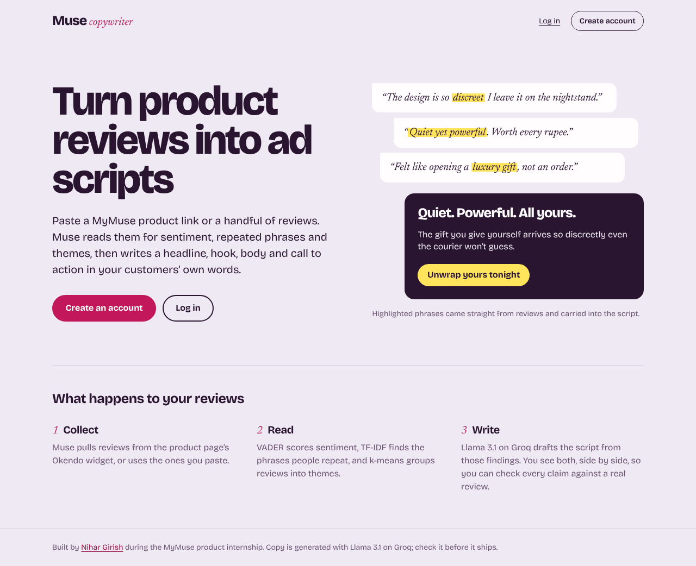
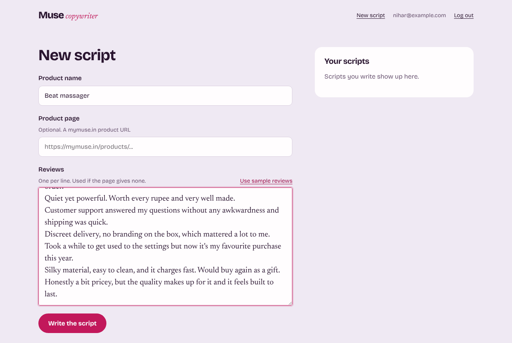
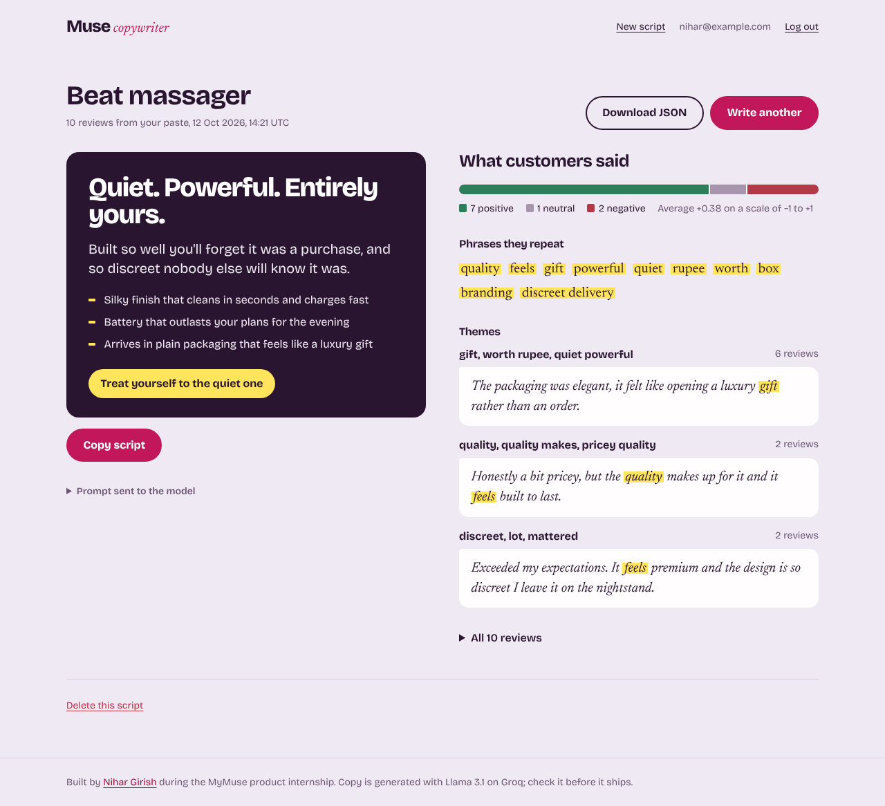

# Muse Copywriter

A Flask app that writes short ad scripts for MyMuse products out of real customer reviews. I built it during my product internship at MyMuse.

Give it a product page or paste some reviews. It scores their sentiment, finds the phrases customers repeat, groups the reviews into themes, and asks Llama 3.1 on Groq for a headline, a hook, three body lines and a call to action.

## How it works

The landing page shows the idea in one picture. Phrases from three reviews carry a yellow highlight, and the script below them reuses those phrases.



After you log in, you start a new script. Name the product, then paste a mymuse.in product link, paste reviews one per line, or click "Use sample reviews" to try it out. Your past scripts sit in the column on the right.



The result puts the script on the left and the evidence on the right: a sentiment bar, the phrases customers repeat, and each theme with the review that best represents it. The same yellow marks every repeated phrase inside the reviews, so you can check each line of copy against something a customer wrote. "Copy script" copies it as labelled plain text, and "Download JSON" saves the whole run.



If you haven't set a Groq key, you still get the full analysis plus the exact prompt, ready to paste into any chat model.

## What happens to the reviews

1. Collect. The scraper reads the Okendo review widget on the product page over plain HTTP. If that finds nothing and you installed the optional extras, it renders the page in headless Chrome. When both fail, the app tells you and asks you to paste reviews.
2. Analyse. VADER scores sentiment. TF-IDF finds key phrases, and it keeps a two word phrase only if customers wrote those words together. k-means groups reviews into up to three themes and picks the review closest to each theme's centre.
3. Write. Groq runs Llama 3.1 on a prompt built from those findings. The app parses the answer into headline, hook, body and CTA. If the model ignores the format, you see its raw answer.

The app saves every run to your account, where you can open, download or delete it. Nobody else can see your runs.

## Project layout

```
app/
  __init__.py      App factory, auth and routes
  analysis.py      Sentiment, phrases, themes, highlight helper
  copywriter.py    Prompt, Groq client, script parser
  scraper.py       Okendo and Shopify review scraper, optional Selenium
  models.py        User and Generation tables (SQLAlchemy)
  templates/       Jinja templates
  static/          CSS, JS, self hosted Bricolage Grotesque and Newsreader
tests/
  test_app.py      Analysis, parsing, routes, access control
docs/screenshots/  Images used in this README
wsgi.py
```

## Run it locally

```bash
python -m venv .venv
source .venv/bin/activate          # Windows: .venv\Scripts\activate
pip install -r requirements-dev.txt
cp .env.example .env               # then add your GROQ_API_KEY

python wsgi.py                     # http://localhost:8000
pytest
```

For the headless Chrome step, install `requirements-scrape.txt` and remove `DISABLE_SELENIUM=1` from `.env`.

## Deploy

`render.yaml` sets up a Render web service. Add `GROQ_API_KEY` in the Render dashboard; Render generates `SECRET_KEY` for you. SQLite works for a demo, but Render wipes the disk on each deploy, so point `DATABASE_URL` at Postgres to keep accounts and scripts.

## Design notes

The interface works like a copywriter's proof sheet:

- Customer words appear in Newsreader, a serif, with a yellow highlighter on repeated phrases. Anything Muse writes appears in Bricolage Grotesque.
- The yellow is the one accent with a meaning. A highlighted phrase came from a customer, and the same yellow marks the script's bullets and call to action.
- Lilac paper and plum ink follow MyMuse's own tone: playful, a little cheeky, still premium.
- The app serves its own fonts and makes no third party requests.

Treat the generated copy as a first draft and read it before it ships.
